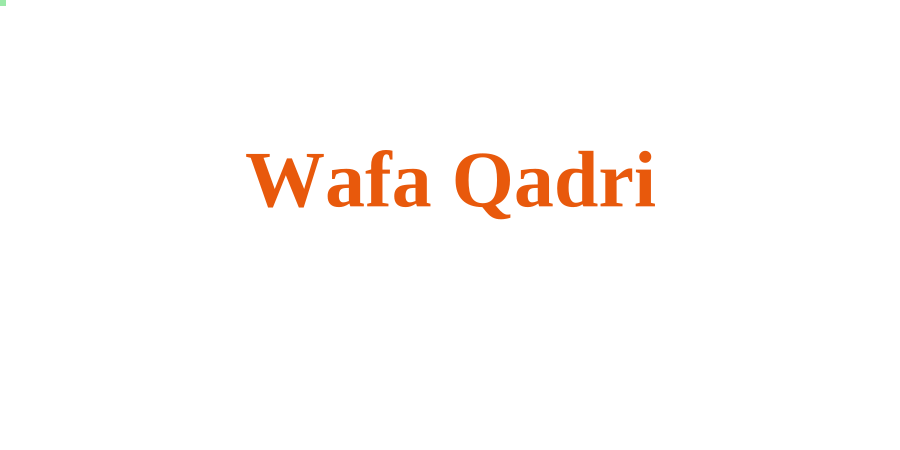

<div align="center">


<a href="https://git.io/typing-svg">
  
</a>

<br/><br/>


</div>

---

## 🖥️ `~/about.sh`

<table>
<tr>
<td width="55%">

```bash
$ cat about_me.txt

name      = "Wafa Qadri"
role      = "B.Tech CSE student"
location  = "Kashmir 🏔️"
status    = "learning, building, breaking"
focus     = ["Cybersecurity", "Ethical Hacking",
             "Digital Forensics", "IoT Security",
             "Cloud", "Data Analysis"]
fun_fact  = "I solve CTFs for fun 🚩"
```

</td>
<td width="45%" align="center">


</td>
</tr>
</table>

---

## 🎯 `./current_missions`

| 🔥 Mission | 📈 Progress |
|---|---|
| Cybersecurity & Ethical Hacking |  |
| Digital Forensics |  |
| IoT & IoT Security |  |
| Cloud Computing |  |
| Data Analysis |  |

*(change the numbers in `progress/60` to whatever you want)*

---

## 🧰 `./toolbox`

<div align="center">


<br/><br/>


</div>

---

## 🚩 `./ctf`

```text
$ ls ctf/
CRYPTO/   WEB/   FORENSICS/   OSINT/   MISC/
```

I play CTFs with team **p53ud0p4n1c** and write up what I learn.
👉 [**Check out my CTF writeups**](https://github.com/wafaqadri/InIt-2026-writeups)

---

## 📊 `./stats`

<div align="center">


<br/>


<br/><br/>



</div>

---

## 📡 `./contact`

<div align="center">

[](https://instagram.com/waffaaaaaaaaaaa._)
[](https://www.linkedin.com/in/wafa-qadri-342200383)
[](mailto:wafaqadri0@gmail.com)


</div>
